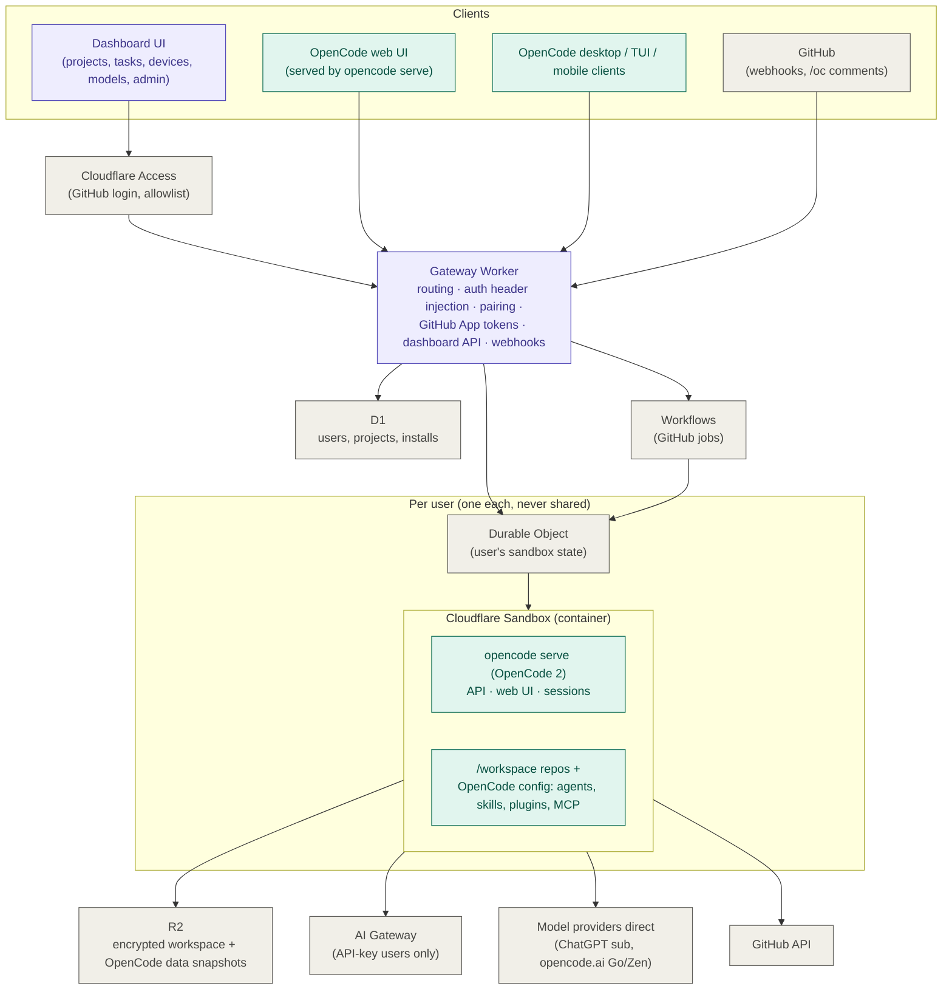

# PLAN — Remote OpenCode platform on Cloudflare

Hand-off plan for building a small multi-user platform where I (and a few invited friends) run a personal, always-available **OpenCode 2** coding agent on **Cloudflare**, and drive it from any PC or phone — to build features, open PRs and review code.

> This plan is self-contained. It was written from a design discussion that the implementer does not have access to. Where it names an API, treat the name as a pointer and **verify it against the current docs** (links at the bottom) before coding against it.

---

## 1. Goal and guiding principle

**Goal:** each user gets their own remote OpenCode server in a Cloudflare sandbox. They reach it from:
- the OpenCode desktop app / TUI on any computer,
- the OpenCode web UI (any browser, including a phone),
- a dashboard I build (projects, tasks, devices, models, admin),
- GitHub (comment on an issue/PR → the agent works and opens/updates a PR).

**Guiding principle — reuse first, build last.**
- If **OpenCode** already does it (chat/coding UI, sessions, diffs, pairing devices, provider logins, agents, skills, plugins, MCP, permissions, GitHub `/oc` action) → use it as-is.
- If **Cloudflare** already does it (containers/sandboxes, login, storage, durable jobs, model gateway) → use it as-is.
- We only build: **(a) a thin gateway Worker** and **(b) the dashboard UI**.
- If you catch yourself building a chat log, diff viewer or terminal in the dashboard — stop and deep-link to the OpenCode web UI instead.

## 2. Architecture



Legend: **purple = we build**, **teal = OpenCode as-is**, **gray = Cloudflare / third party as-is**.

### Request routing
- `app.<domain>` → dashboard (Workers static assets) behind **Cloudflare Access** (GitHub IdP, email/username allowlist). Access identity → user record in D1.
- `<user>.<domain>` → gateway → that user's Durable Object → that user's sandbox → `opencode serve`. The gateway adds OpenCode's Basic auth (`opencode:<per-sandbox password>`); users never see that password. Browsers/apps authenticate to their subdomain via **OpenCode's own pairing** (session cookie / token), not via Access, because native OpenCode clients can't complete an Access login.
- `api.<domain>/github/webhook` → gateway → Workflow.

## 3. Components

### 3.1 Sandbox image (`sandbox/`)
- Base on Cloudflare's sandbox image + Node/Bun, `git`, `ripgrep`, `gh` (optional), build tools.
- **Pin the OpenCode 2 version** (model list and event formats change between releases).
- Start `opencode serve` (standalone mode, foreground) on a fixed port, `OPENCODE_PASSWORD` from the Worker (one random password per user, stored encrypted in D1 / DO).
- Disable auto-update and telemetry/share features inside the container.
- Bake in OpenCode config: default agents, skills, plugins (e.g. an `open_pr` tool that calls back to the gateway), MCP servers, and **permission rules** (no `git push --force`, no pushes outside the user's installed repos, etc.).
- Use OpenCode **server plugins** for the custom parts: `ctx.tool.transform` for `open_pr`, `permission.hook("evaluate")` / `shell.hook("create.before")` to enforce the push rules in code, `session.hook("model.request")` to route API-key traffic through AI Gateway. Plugins can't add HTTP routes or hook incoming auth, so routing and pairing stay in the gateway.
- Outbound allowlist (Sandbox outbound control): GitHub, AI Gateway, OpenAI/ChatGPT auth + Codex endpoints, opencode.ai (Go/Zen), package registries. Everything else blocked.

### 3.2 Gateway Worker (`apps/gateway/`)
- Subdomain router → per-user Durable Object (`idFromName(userId)`) → sandbox fetch / port proxy (check Sandbox SDK docs for the right way to proxy HTTP + SSE/WebSocket to a container port).
- Wake/sleep lifecycle: on first request, start sandbox, restore snapshot from R2, start `opencode serve`, wait for health (`/api/info` or health route).
- **Pairing endpoint** for the dashboard: call OpenCode's create-pairing-code route (`POST /api/pair`) inside the user's sandbox and return the one-time link + QR to the dashboard.
- **Dashboard API**: projects (clone repo), tasks (create session + prompt via `@opencode/client`), status, models (proxy the integration/connect routes), admin (invite/remove users).
- **GitHub App token minting**: short-lived installation tokens, scoped to the user's installation; injected on the way out (placeholder credential inside the container, real token swapped in by the outbound proxy) so no long-lived secret lives in a sandbox.
- **Webhooks**: verify signature → enqueue a Workflow.
- **Never** proxy or log responses from `GET /api/credential` (it returns secrets) to dashboard code; strip/deny it for dashboard-originated calls.

### 3.3 Dashboard (`apps/dashboard/`)
React app on Workers static assets, behind Access. Uses `@opencode/client` (browser-compatible) through the gateway.

| Screen | Purpose | Backed by |
| --- | --- | --- |
| Projects | Connect a GitHub repo via our GitHub App; clone into the sandbox | GitHub App + sandbox exec |
| Tasks | "Build X", "Review PR #12", "Fix issue #40" → creates an OpenCode session, live status | OpenCode session + event stream APIs |
| Open in OpenCode | One click into the OpenCode web UI on that session | Deep link to `<user>.<domain>` |
| Devices | QR / link to pair the desktop and mobile apps | OpenCode pairing (`POST /api/pair`) |
| Models | Connect subscriptions/keys (see 3.4) | OpenCode integration API |
| Settings / admin | Sandbox status (wake/sleep/snapshot), invite friends, allowlist | D1 + Access policy |

### 3.4 Models — friends use their own subscriptions
Logins are done by OpenCode itself and stored **inside that user's sandbox**.

| Card | Method | OpenCode API (verify) |
| --- | --- | --- |
| Sign in with ChatGPT (Plus/Pro) | **Headless / device-code** method only (the browser method's local callback would land on the sandbox, not the user's device). Paste-redirect-URL `complete` route as fallback. | `GET /api/integration`, `POST /api/integration/{id}/connect/oauth`, poll `GET …/connect/oauth/{attemptID}`, `POST …/{attemptID}/complete` |
| OpenCode Go / Zen | Paste the OpenCode console API key | `POST /api/integration/{id}/connect/key` |
| Other API key | Pick provider, paste key (optionally route via AI Gateway) | `POST /api/integration/{id}/connect/key` |

"Connected" state = provider appears in `GET /api/provider`. Claude Pro/Max subscriptions are **not** supported (Anthropic forbids third-party use); Claude needs an API key. One account per person — never share a subscription login between users.

### 3.5 GitHub integration
- **Our own GitHub App** (contents, pull requests, issues, checks). Each user installs it on their repos; installation ↔ user stored in D1.
- Phase 1: also enable OpenCode's built-in GitHub Action (`/opencode`, `/oc` comments, auto-review on PR open) on repos — zero code, runs in GitHub Actions.
- Phase 2: our webhooks → **Workflow**: map repo → owning user → wake their sandbox → create session with the issue/PR context → prompt → wait → push branch / open or update PR / post review comment. Retries come from Workflows.

### 3.6 Persistence
- Snapshot `/workspace` **and OpenCode's data directory** (sessions + provider credentials) to R2 on idle/stop; restore on start. **Encrypt** snapshots per user (key held by the Worker, not the container).
- Implemented (M1) with `DirectoryBackup` from `@cloudflare/sandbox`: everything persistent lives under `/persist` and is backed up as one R2 object, restored before `opencode serve` starts. Encryption is R2's at-rest encryption; per-user keys need a custom pipeline (DirectoryBackup has no hook) and are deferred. Container snapshots were rejected: tied to the image version and expire after 30 days.
- D1: users, GitHub identities, installations, projects, sandbox metadata. Durable Object: live state (awake/asleep, last activity, active sessions).

## 4. Security rules (non-negotiable)
1. One sandbox per user. A routing bug that sends user A to user B's sandbox exposes B's code **and** B's ChatGPT/Go login. Add tests for this.
2. Container never holds long-lived secrets (GitHub, AI Gateway): placeholder + outbound swap.
3. Locked-down outbound allowlist; OpenCode permission rules baked into the image.
4. Don't log OpenCode API responses; never surface `/api/credential`.
5. Access allowlist controls who can sign up; the admin can revoke (destroy sandbox + delete snapshot).

## 5. Repo layout
```
apps/dashboard      React UI (Workers static assets)
apps/gateway        Worker: routing, dashboard API, pairing, webhooks, DOs, Workflows
sandbox/            Dockerfile + OpenCode config (agents, skills, plugins, permissions)
packages/shared     types shared by dashboard and gateway
PLAN.md             this file
```
Use `wrangler` (Workers Paid plan required for Sandbox/Containers), TypeScript throughout.

## 6. Milestones (each ends with a demo-able check)

**M0 — Spike: one sandbox, real OpenCode UI (do first, it de-risks everything)**
- Sandbox image with pinned OpenCode 2, `opencode serve` + `OPENCODE_PASSWORD`.
- Gateway proxies `me.<domain>` to it, including SSE/WebSocket.
- ✅ OpenCode web UI fully works under the proxied subdomain (assets, cookies, live streaming).
- ✅ Desktop app connects via a pairing link created with `POST /api/pair`.

**M1 — Persistence**
- Encrypted R2 snapshot/restore of `/workspace` + OpenCode data dir; idle sleep.
- ✅ Kill the container, reconnect: repos, sessions and provider login are still there.

**M2 — GitHub App**
- App, install flow, token minting, outbound swap; clone + push + open PR.
- ✅ From the OpenCode UI: "add a README section and open a PR" produces a PR authored by the app.

**M3 — Multi-user**
- Access (GitHub IdP), D1 users, DO per user, per-user subdomain + password.
- ✅ Second account gets its own sandbox; isolation tests pass (A cannot reach B).

**M4 — Dashboard**
- Projects, Tasks, Open in OpenCode, Devices, Settings.
- ✅ Start a task from the dashboard on a phone, watch status, open it in the OpenCode UI.

**M5 — Models screen**
- ChatGPT headless sign-in, Go/Zen key, other keys.
- ✅ A friend connects their own ChatGPT subscription from their phone and runs a task on it.

**M6 — GitHub-triggered work**
- OpenCode GitHub Action on repos (quick win), then webhooks → Workflows → user's sandbox.
- ✅ Comment "/oc fix this" on an issue → PR appears; open PR → review comment appears.

## 7. Verify early / open questions
- Exact OpenCode 2 route names and payloads (pairing, integration/connect, sessions, events) — check the OpenAPI document.
- Where OpenCode 2 stores its data/credentials inside the container (path to snapshot).
- Best way to proxy HTTP + SSE/WebSocket from a Worker into a Sandbox port (preview URLs vs container fetch).
- Container sleep/idle settings and cost per user; snapshot size limits.
- Whether the OpenCode web UI needs any `cors` / base-URL config behind the proxy.

## 8. References
- OpenCode web, service, pairing, auth: https://opencode.ai/docs/cli/web
- OpenCode HTTP API (v2): https://opencode.ai/v2/docs/api — OpenAPI: https://opencode.ai/docs/openapi.json
- OpenCode client (`@opencode/client`): https://opencode.ai/v2/docs/build/client/
- OpenCode server plugins (tools, permission/shell/model hooks, plugin storage): https://opencode.ai/docs/build/plugins/server
- OpenCode embedded SDK (`@opencode/sdk`; not needed, we run `opencode serve` and use `@opencode/client`): https://opencode.ai/docs/build/sdk/
- OpenCode in a Durable Object (`@opencode/sdk/workerd`; no container and state in DO storage, but no filesystem or shell, so it can't clone or build. Revisit for repo-less tasks or if it gains a filesystem): https://opencode.ai/docs/build/sdk/cloudflare/
- OpenCode GitHub integration: https://opencode.ai/docs/github/
- OpenCode Go: https://opencode.ai/docs/go/
- Cloudflare Sandbox SDK: https://developers.cloudflare.com/sandbox/
- Run OpenCode in a Cloudflare sandbox (reference only; uses one-shot `opencode run`): https://developers.cloudflare.com/sandbox/coding-agents/opencode/
- Cloudflare Agents SDK OpenCode 2 harness (experimental, watch only): https://developers.cloudflare.com/changelog/post/2026-10-12-opencode-harness/
- Cloudflare Access, D1, R2, Workflows, AI Gateway: https://developers.cloudflare.com/
