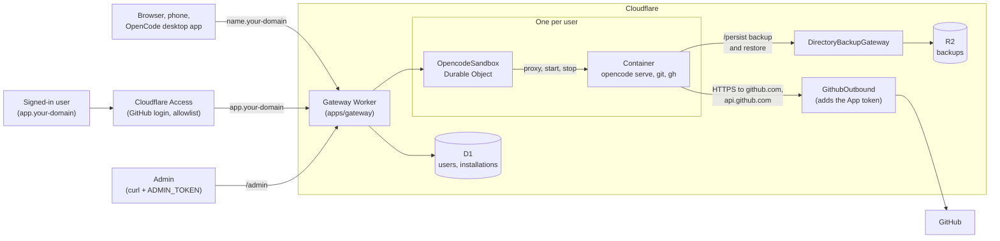

# cinder-agent

My setup for running [OpenCode](https://opencode.ai) on Cloudflare, so I can use it from any
browser, my phone or the OpenCode desktop app.

Each invited user gets their own `opencode serve` in its own [Cloudflare container](https://developers.cloudflare.com/containers/),
behind a small Worker. It's reachable at `https://<name>.<your-domain>`, and you sign in with
OpenCode's pairing links, which you get from `https://app.<your-domain>` after signing in with
GitHub through Cloudflare Access.

A sandbox stops after 30 minutes idle by default. Before it stops, its files, sessions and model
logins are backed up to R2 and restored on the next start. Changes made since the last stop are
lost if the container dies unexpectedly.

## Architecture



The gateway looks up which user owns `<name>.<domain>` in D1 and routes to that user's Durable
Object (named by the user's ID, not the sandbox name), which starts the container, restores
`/persist` from R2 and proxies requests to `opencode serve`. The container only has a placeholder
GitHub token; its traffic to GitHub goes through `GithubOutbound`, which adds a short-lived token
for that user's GitHub App installation.

**Work in progress.** See [PLAN.md](PLAN.md) for what's next.

## Requirements

- Cloudflare account on the Workers Paid plan (needed for Containers)
- A domain on Cloudflare
- Docker
- [Gitleaks](https://github.com/gitleaks/gitleaks) (`brew install gitleaks`), used by the pre-commit hook
- [Vite+](https://viteplus.dev) (`vp`)

## Deploy

1. Install dependencies and log in:

   ```bash
   vp install
   ```

   ```bash
   vp -C apps/gateway exec wrangler login
   ```

2. In [apps/gateway/wrangler.jsonc](apps/gateway/wrangler.jsonc), replace `example.com` (in
   `SANDBOX_DOMAIN` and `routes`) with your domain.
3. Add a DNS record in Cloudflare: `AAAA`, name `*`, content `100::`, proxied.
4. Create the R2 bucket for backups and the D1 database for users, then create the tables. Add the
   `database_id` that `d1 create` prints to `d1_databases` in `wrangler.jsonc`.

   ```bash
   vp -C apps/gateway exec wrangler r2 bucket create cinder-agent-backups
   ```

   ```bash
   vp -C apps/gateway exec wrangler d1 create cinder-agent
   ```

   ```bash
   vp -C apps/gateway exec wrangler d1 migrations apply cinder-agent --remote
   ```

5. Set up [sign-in](#sign-in) with Cloudflare Access and set `ACCESS_AUD` in `wrangler.jsonc`.

6. Set up the [GitHub App](#github), which adds `GITHUB_APP_PRIVATE_KEY` to `.secrets.env`.
   Then deploy with an admin token:

   ```bash
   echo "ADMIN_TOKEN=$(openssl rand -hex 32)" >> apps/gateway/.secrets.env
   ```

   ```bash
   vp -C apps/gateway exec wrangler deploy --secrets-file .secrets.env
   ```

7. Invite yourself (see [Users](#users)), open `https://app.<your-domain>`, sign in and press
   **Pair a device**. The link is valid 5 minutes and works once; open it in a browser or paste it
   into the OpenCode desktop app.

## Sign-in

`app.<your-domain>` is behind [Cloudflare Access](https://developers.cloudflare.com/cloudflare-one/access-controls/applications/http-apps/self-hosted-public-app/).
Sandbox hostnames are not, because the OpenCode apps can't complete an Access login; they use
OpenCode's pairing instead.

1. In Zero Trust, add [GitHub as a login method](https://developers.cloudflare.com/cloudflare-one/integrations/identity-providers/github/).
2. Add a self-hosted application for the hostname `app.<your-domain>` only, with GitHub as its
   login method and an Allow policy listing the emails (or GitHub organization) you invite.
3. Copy the application's Audience (AUD) tag into `ACCESS_AUD` in `wrangler.jsonc`.

The gateway reads the signed-in email from [`ctx.access`](https://developers.cloudflare.com/workers/configuration/cloudflare-access/)
and only accepts it for that AUD tag. Someone who passes Access but hasn't been invited gets 403.

## Users

Each user has an email (what Access signs them in with), a sandbox name (their subdomain) and at
most one GitHub App installation. With `A="Authorization: Bearer <ADMIN_TOKEN>"` and
`GW=https://<worker>.workers.dev`:

```bash
curl -H "$A" -H 'content-type: application/json' -d '{"email":"ada@example.com","sandbox":"ada"}' $GW/admin/users
```

```bash
curl -H "$A" $GW/admin/users
```

```bash
curl -X PUT -H "$A" -H 'content-type: application/json' -d '{"installationId":12345678}' $GW/admin/users/<id>/github
```

```bash
curl -X DELETE -H "$A" $GW/admin/users/<id>
```

Deleting a user destroys their container, backup and sandbox state, and retires the sandbox name
so it is never given to anyone else. Remove them from the Access policy too. The admin can also
pair, check or stop any sandbox with `POST /admin/sandboxes/<name>/pair`, `GET` and `DELETE
/admin/sandboxes/<name>`.

## GitHub

Sandboxes can clone, push and open pull requests as your own GitHub App. The sandbox only has a
placeholder token; the gateway swaps in a short-lived installation token on its way to GitHub.

1. [Create a GitHub App](https://github.com/settings/apps/new) with webhooks off and these
   repository permissions: Contents, Pull requests, Issues and Checks (read and write).
2. Install it on your repositories, and have each user install it on theirs. The installation ID
   is the number at the end of the installation's settings URL. Link it to the user with
   `PUT /admin/users/<id>/github` (see [Users](#users)).
3. Generate a private key and convert it to PKCS#8:

   ```bash
   openssl pkcs8 -topk8 -nocrypt -in app.private-key.pem -out app.pkcs8.pem
   ```

4. Set `GITHUB_APP_ID` in `wrangler.jsonc`, and add the key to
   `.secrets.env` on one line:

   ```bash
   printf 'GITHUB_APP_PRIVATE_KEY="%s"\n' "$(awk '{printf "%s\\n", $0}' app.pkcs8.pem)" >> apps/gateway/.secrets.env
   ```

Inside the sandbox, `git` and `gh` work as usual. Commits and pull requests show up as
`<app-name>[bot]`. A sandbox picks up a changed installation when it next starts; to restart it now,
stop it with `DELETE /admin/sandboxes/<name>`.

## Local development

```bash
cp apps/gateway/.dev.vars.example apps/gateway/.dev.vars
```

```bash
vp run dev
```

`vp run dev` creates the local D1 tables. Invite a user (`scripts/smoke.sh` invites
`me@example.com` as `me`), then sandboxes are at `http://<name>.localhost:8787`.
`http://app.localhost:8787` signs you in as the `access.dev` identity in `wrangler.jsonc`; change
its email to act as another user. `vp run ready` runs the checks, [knip](https://knip.dev) and the
tests. See [CONTRIBUTING.md](CONTRIBUTING.md) before opening a pull request.
